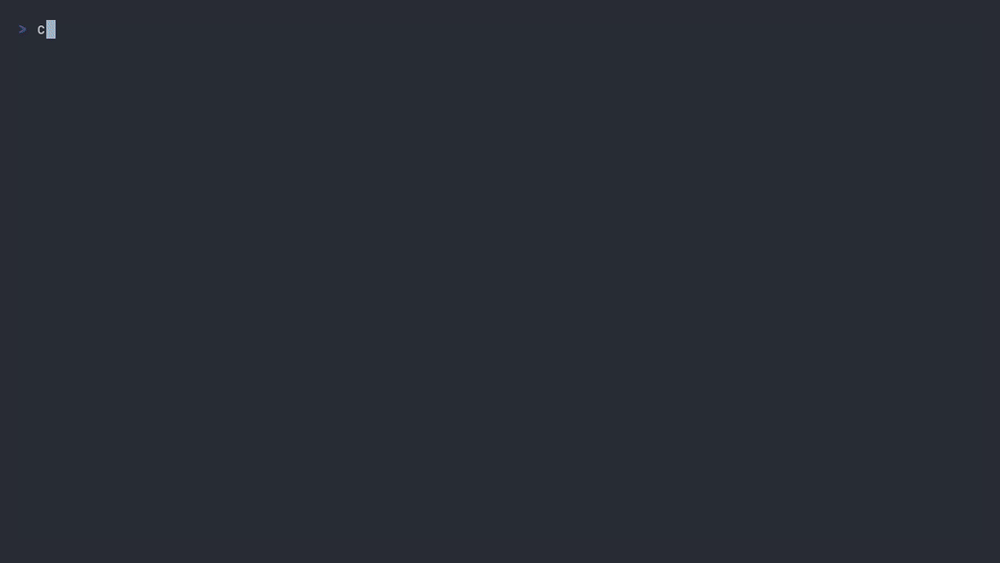

# mdview

[English](README.md) | [中文](docs/README.zh-CN.md)

A Markdown viewer for the terminal. Point it at a `.md` file and you get scrolling, search, an
outline sidebar and mermaid diagrams — and **the screen follows your editor's saves**.
Cross-platform (Linux / macOS / Windows), pure Rust: no Node, no browser, no server.



```
mdview README.md
```

## Features

- **Full-terminal TUI** — draws on the alternate screen and hands your shell back untouched on exit.
- **CommonMark + GFM** — headings, lists, task lists, tables, strikethrough, footnotes, math,
  front matter, syntax highlighting (rendering is done by
  [`tui-markdown`](https://crates.io/crates/tui-markdown)).
- **CJK-friendly wrapping** — wraps by display width, so Chinese text doesn't skew tables and
  code frames.
- **mermaid diagrams in text** — `graph` / `flowchart` / `sequenceDiagram` / `pie` /
  `classDiagram` / `gantt` and more are drawn as box-drawing art
  ([`mermaid-text`](https://crates.io/crates/mermaid-text)), squeezed step by step to fit the
  column budget. A diagram that won't parse is pasted back as a code block with a status-bar
  warning instead of taking the screen down.
- **Live reload** — watches the containing directory (so editor rename-swap is caught too) and
  re-renders 250 ms after the last write.
- **Browse a folder** — point it at a directory, or at nothing at all, and `]` / `[` walk the `.md`
  files sitting next to the one you are reading (natural order, so `part2` comes before `part10`).
- **Follow links** — `gx` jumps to a `#heading`, opens `other.md` (also `other.md#heading`), or
  swaps into a linked directory. External URLs are printed in the status bar, never handed off.
- **Search** — `/` takes a regex (or plain text), highlights as you type, `n` / `N` cycle with
  wrap-around, the status bar shows `3/17`. A sentence split over three rows still matches as one
  string, and only the rows it actually touches light up.
- **Outline sidebar** — `o` toggles it, the selection tracks where you are reading, `Enter` jumps.
- **Readable measure** — `--max-width 90` caps the body width; the rest becomes margin.
- **Themes** — dark and light palettes; `NO_COLOR` and `TERM=dumb` degrade to colourless / ASCII.
- **Config file + completions** — six TOML keys (`max_width`, `theme`, `mermaid`, `outline`,
  `no_watch`, `no_mouse`), flags still win; `--print-completion bash|zsh|fish` prints the hints.
- **Leaves the terminal clean** — normal exit, `Ctrl-C` and even a panic all restore raw mode, the
  alternate screen and mouse capture.

## Install

```sh
# one line, no cargo needed (Linux x86_64/aarch64, Apple Silicon macOS, Windows x86_64)
curl -fsSL https://raw.githubusercontent.com/pengchangg/mdview/main/install.sh | sh
#   MDVIEW_PREFIX=~/.local/bin MDVIEW_VERSION=0.4.0 sh install.sh   # pick prefix / version

brew tap pengchangg/mdview && brew install mdview   # same archives, sha256 pinned in Formula/

cargo install mdview-rs       # from crates.io (the binary is still `mdview`)
cargo install --path .        # from this checkout
cargo build --release         # binary at target/release/mdview
```

`install.sh` needs glibc (Alpine/musl: use `cargo install`), and there is no Intel macOS archive —
that one goes through cargo too.

The crate is published as **`mdview-rs`** only because the name `mdview` was taken on crates.io
back in 2020; the library and the command are both still called `mdview`.

Tag a release with `scripts/tag.sh 0.4.0`: it syncs the version into `Cargo.toml` and `Cargo.lock`,
commits, pushes, then tags. GitHub Actions publishes four archives (Linux x86_64 / aarch64, macOS
arm64, Windows x86_64) plus the crates.io release from that tag. The same workflow then hashes the
archives it just published, rewrites `Formula/mdview.rb` and commits it back to `main`, so the
Homebrew tap never lags a release. `scripts/formula.sh <version>` does that step by hand whenever
you need it.

## Usage

```sh
mdview README.md                 # open a file
mdview docs/                     # open the first .md in a directory
mdview                           # ... or the first .md in the current directory
mdview docs/notes.md --outline   # start with the outline open
mdview book.md --max-width 90    # narrow reading column
mdview big.md --no-watch         # don't watch the file
mdview chart.md --mermaid off    # show mermaid blocks as code
mdview x.md --theme light        # light terminal
mdview x.md --no-mouse           # start without mouse capture
```

## Keys

| Key | Action |
| --- | --- |
| `j` `k` `↑` `↓` | scroll one line |
| `d` `u` | half page |
| `f` `b` `PgDn` `PgUp` | full page |
| `gg` `G` `Home` `End` | top / bottom (`g` is a prefix key, like vim's) |
| `]` `[` | next / previous `.md` in the same directory, wraps around |
| `gx` | follow the link at or below the cursor: `#anchor` → jump, `a.md` / `a.md#h` → open it, `dir/` → swap into it, URL → print it |
| `/` | regex search — case-insensitive unless the pattern ends with `\C` (`\c` forces it back on); `Enter` keep, `Backspace` delete, `Ctrl-U` clear, `Esc` cancel |
| `n` `N` | next / previous match, wraps |
| `o` | toggle the outline (focus moves into it when opened) |
| `Tab` | move focus between body and outline |
| `j` `k` `g` `G` `Enter` | in the outline: move / jump to that heading |
| `Esc` | outline → body; with no search term → quit |
| wheel | scroll the focused pane |
| left click | select and jump to an outline entry |
| `m` | toggle mouse capture — off restores native terminal selection |
| `?` | help overlay (any key closes it) |
| `q` `Esc` `Ctrl-C` | quit |

## Rendering conventions

- Headings don't print their `#` (this is a preview, not a source editor); the level comes from
  colour and weight. Code blocks aren't wrapped in ``` fences either. Both are switched off in
  `theme.rs` by returning empty strings from `heading_marker` / `code_block_fence`.
- The outline maps lines back to headings by comparing the line style against
  `heading(level)` plus a text prefix, so a `#` comment inside a code block never becomes a heading.

## Configuration

```toml
# ~/.config/mdview/config.toml
max_width = 90
theme = "dark"        # auto | dark | light
mermaid = "auto"      # auto | off
outline = true
no_watch = false
no_mouse = false
```

Looked up in this order: `$MDVIEW_CONFIG` (a file path; it must exist) →
`$XDG_CONFIG_HOME/mdview/config.toml` → `~/.config/mdview/config.toml`. Command-line flags win over
the file, the file wins over the built-in defaults. Anything wrong in it — unknown key, bad type,
broken TOML — stops startup and prints the path it read, rather than being ignored. A `max_width`
below 20 is clamped to 20 with a status-bar note.

## Known limits (v0.4)

- Links are followed with the keyboard (`gx`), not the mouse: there is no hit-testing of spans, and
  external URLs are never launched (they print in the status bar — `Ctrl+click` on the OSC 8 link
  still works in terminals that support it). Links are read from the source, so an exotic reference
  (`<a b.md>`, `%20`-escaped) may land as "not found". No file tree, no tabs.
- Search syntax is the [`regex`](https://docs.rs/regex) crate's — `a|b`, `(ab)+`, `\b`, `(?i)` —
  not vim's: metacharacters are written bare and `\v`/`\V` mean nothing here — to find a literal
  `$` search `\$`. It compiles to a
  linear-time automaton, so no catastrophic backtracking, but backreferences and lookahead
  (`\1`, `(?=…)`) are not supported.
- A hit that spans a soft wrap lights the rows it touches, not the whole paragraph; zero-width
  matches (`a*`) are skipped since there is nothing to highlight. An unfinished pattern (an
  unclosed `(`) shows the reason in the status bar instead of an error dialog.
- Fuzzy matching: no. The search box has `Backspace` and `Ctrl-U` but no cursor keys.
- mermaid renders as text, never as an image: no `mmdc`, Node or Chromium, and no image protocol
  (Alacritty and Windows Terminal support neither Kitty nor ichthys).
- Watching is per-directory (that is what catches an editor's rename-swap), and the config file has
  six keys — no `[theme.dark]` sections, so the palette can be picked, not retuned.
- With mouse capture on, the terminal can't select text — press `m`.
- Two small upstream warts in [`mermaid-text`](https://crates.io/crates/mermaid-text): after a
  `gitGraph` merge the commit dot is off by one, and `«interface»` in `classDiagram` can overlap a
  border by one cell. Still readable; waiting on upstream.

## Development

```sh
cargo test                                              # unit + snapshot + logic tests, no terminal
INSTA_UPDATE=always cargo test --test render_snapshot   # refresh snapshots after a render change
cargo run -- examples/demo.md
cargo clippy --all-targets -- -D warnings
vhs examples/demo.tape                                  # record the demo gif (vhs + ttyd/tmux/ffmpeg + a CJK font)
```

The code is split in two: `render` / `wrap` / `search` / `mermaid` / `app` are pure logic (not one
line of terminal IO, which is why they are all testable), and only `view` / `term` / `event` /
`main` touch the screen. Rendering has a single entry point, `mdview::to_doc(src, width, opts)`:
a width change re-renders, a height change only clamps the scroll offset.

Measured (release build, 1 MB of mixed CJK/Latin with plenty of code blocks): 369 ms to render the
whole document into 56,609 lines at 100 columns; a full search rescan costs 6.8 ms per keystroke
(a regex query compiles once per keystroke and rescans in the same order: 1.4 ms on 0.5 MB).

## License

MIT
