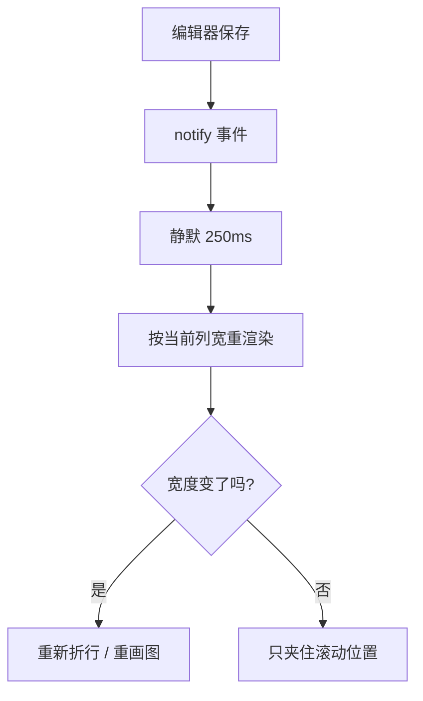
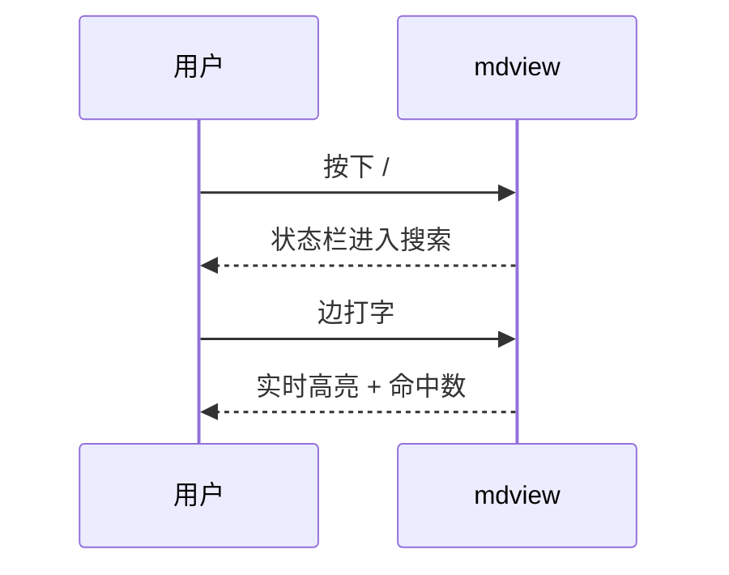

# mdview 演示

在终端里预览 Markdown。左边正文，`o` 打开大纲，`/` 搜索，`]` `[` 换文件，保存文件立刻重绘。

## 行内样式

**粗体**、*斜体*、~~删除线~~、`行内代码`、[链接](https://example.com)、任务列表：

- [x] 滚动与代码高亮
- [x] 保存即刷新
- [x] 链接跳转（`gx`，锚点 / 文件 / 目录）

## 代码

```rust
fn main() {
    let doc = mdview::preview("# hello", 80, opts);
    println!("{} 行", doc.lines.len());
}
```

## 表格

| 键 | 作用 | 备注 |
| --- | --- | --- |
| `j` `k` | 上下滚一行 | 也支持方向键 |
| `d` `u` | 半页 | |
| `f` `b` | 整页 | |
| `gg` `G` | 首行 / 末行 | |
| `]` `[` | 同目录下一份 / 上一份 | 到头环绕 |
| `gx` | 跟随链接 | `#锚点`、`a.md`、`dir/` |
| `/` | 搜索 | `n` `N` 上下个匹配，跨软拆行也能命中 |
| `o` | 大纲开关 | `Tab` 切焦点，`Enter` 跳转 |
| `m` | 鼠标开关 | 关掉就能用终端选中复制 |
| `?` | 帮助 | `q` 退出 |

## 引用与公式

> 排版交给 tui-markdown，我们只管滚动、搜索和重绘。

行内公式 $e^{i\pi} + 1 = 0$。

## Mermaid





## 中文排版

中英文混排时的宽度计算很重要：一个汉字的显示宽度是 2 列，`unicode-width` 负责这件事，
所以按列折行不会把表格和代码框画歪。
